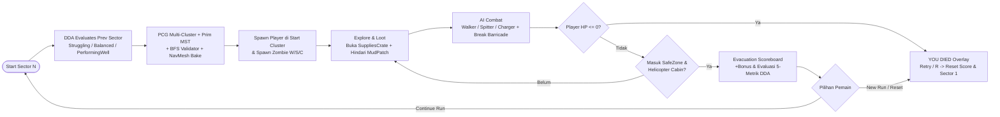
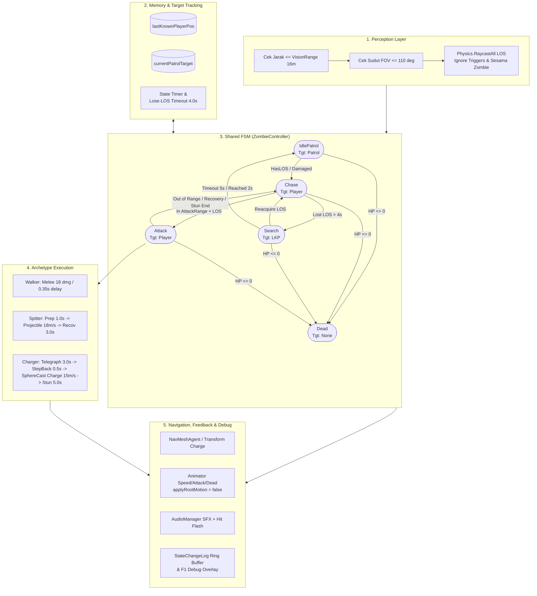
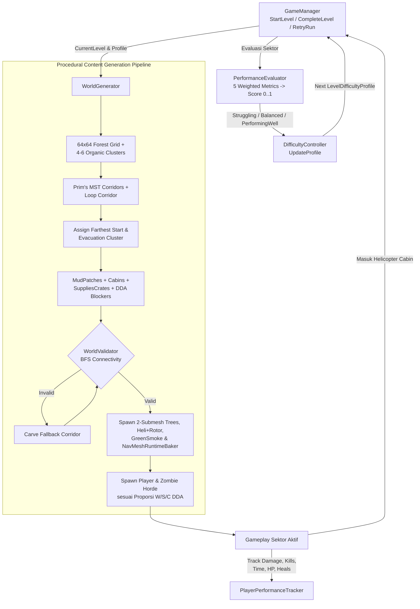

# Dokumentasi Resmi Final Project / EAS: **Dead Depths**

**Mata Kuliah:** Game Cerdas (Pertemuan 15 — Standar Rubrik Slide 63, 70–73, 82, & 83)  
**Engine:** Unity `6000.6.0f1` (Universal Render Pipeline / URP)  
**Branch Repository:** `Tugas_Akhir`  
**Build Standalone:** `Builds/DeadDepths.exe` (`productName: DeadDepths`)  
**Scene Utama:** `Assets/Scenes/DeadDepths.unity`

---

## 1. Identitas & Pembagian Tugas Kelompok *(Slide 63 / 70)*

> **Catatan Pengisian:** Silakan lengkapi kolom **Nama Lengkap** dan **NIM / NRP** sebelum pengumpulan / presentasi EAS.

| Peran (Slide 63) | Nama Lengkap | NIM / NRP | Tanggung Jawab Teknis di `DeadDepths` | Modul Kode Utama |
| :--- | :--- | :--- | :--- | :--- |
| **Role 1 — Gameplay, Player & Audio/Visual Feedback Lead** | *[Isi Nama Anggota 1]* | *[Isi NRP 1]* | Kontrol isometrik, Stamina, Punch & Occlusion, Crate interaction, HUD/Scoreboard, URP Obstruction Fade, AudioManager, Animasi tanpa Root-Motion drift | `DeadDepthsPlayerController.cs`, `IsometricCameraController.cs`, `ObstructionFadeController.cs`, `SuppliesCrate.cs`, `ExtractionHelicopter.cs`, `AudioManager.cs`, `DeadDepthsHUD.cs`, `CompletionScreenUI.cs` |
| **Role 2 — Enemy AI, Navigation & Debug Inspector Lead** | *[Isi Nama Anggota 2]* | *[Isi NRP 2]* | Perception (FOV + Raycast LOS), Memory (`LastKnownPlayerPos`), Shared FSM + Sub-state (Walker, Spitter, Charger), Projectile & Telegraph, NavMesh + Physics override, `[F1]` AI Debug Mode & State Change Log | `ZombieController.cs`, `ZombieArchetype.cs`, `SpitterProjectile.cs`, `ChargerTelegraph.cs`, `DeadDepthsDebugMode.cs` |
| **Role 3 — PCG, DDA, Build Pipeline & QA Lead** | *[Isi Nama Anggota 3]* | *[Isi NRP 3]* | Multi-Cluster PCG + Prim's MST + BFS Validator, Procedural Geometry (2-submesh tree, crate, mud, helicopter & rotor), Runtime NavMesh Baking, 5-Metric DDA, Scene Builder & Automated Tests, Dokumentasi | `WorldGenerator.cs`, `WorldValidator.cs`, `ProceduralGeometry.cs`, `PCGData.cs`, `NavMeshRuntimeBaker.cs`, `PerformanceEvaluator.cs`, `PlayerPerformanceTracker.cs`, `DifficultyController.cs`, `GameManager.cs`, `DeadDepthsSceneBuilder.cs`, `DeadDepthsAutomatedTests.cs` |

---

## 2. Konsep Game & *Vertical Slice Scope* *(Slide 70)*

### 2.1 Konsep Game
**Dead Depths** adalah game **3D Isometric Zombie-Survival Dungeon Crawler** yang berlatar kawasan hutan terbengkalai dengan struktur kabin rusak, area berlumpur, dan titik evakuasi helikopter. Pemain harus menavigasi peta semi-open-world yang dibangun secara prosedural setiap sektor, membuka *Supplies Crate* untuk memulihkan HP dan mengumpulkan skor, menghadapi tiga arketipe zombie dengan perilaku taktis berbeda (**Walker**, **Spitter**, **Charger**), serta mencapai helikopter evakuasi di zona aman terjauh.

### 2.2 *Vertical Slice Scope*
Fokus pengembangan pada tahap *vertical slice* (EAS) mencakup **sistem inti kecerdasan buatan dan generasi prosedural terintegrasi** tanpa ekspansi UI/polishing non-esensial:
- **Termasuk dalam scope:**
  - Gameplay inti 3D isometrik (gerak, sprint/stamina, crouch, melee punch, crate looting, mud slow, death & retry, helicopter extraction).
  - 3 arketipe zombie berbasis Shared FSM + sub-fase unik, persepsi FOV + Line-of-Sight, memori posisi terakhir pemain (*LKP*), serta navigasi NavMesh + physics charge override.
  - Multi-cluster PCG berbasis Prim's MST + BFS connectivity validator + runtime NavMesh baking.
  - DDA 5-metrik untuk adaptasi komposisi zombie, suplai medis, kualitas loot, dan jumlah penghalang antar-sektor.
  - Mode Debug `[F1]` lengkap (status FSM, target aktif, `[PATROL DEST]`, `[SEARCH TARGET]`, *AI State Change Log*, FOV/LOS/NavMesh path overlay, minimap grid PCG, dan parameter DDA aktif).
  - Asset PBR non-default (`Yughues` materials, FBX karakter beranimasi, library SFX, partikel asap hijau URP, serta URP *see-through* kamera).
- **Di luar scope *vertical slice* (sengaja ditunda):**
  - Title Screen / Main Menu, Pause Menu (`ESC`), sistem Inventory senjata api (*Rifle/Pistol* saat ini tercatat sebagai *score/loot notification*), health bar mengambang di atas kepala zombie (digantikan inspeksi `[F1]` Debug Mode & hit flash), serta propagasi suara *gameplay*.

---

## 3. *Gameplay Loop* *(Slide 70)*

---

## 4. Penjelasan Teknik AI, PCG, DDA & Asset Feedback *(Slide 70–71)*

### 4.1 Game AI Zombie (`ZombieController.cs`, `ZombieArchetype.cs`)
Setiap zombie menggunakan arsitektur **Perception $\rightarrow$ Memory $\rightarrow$ Shared FSM $\rightarrow$ Archetype Action**:
1. **Perception (`CanSeePlayer` & `HasUnobstructedLineOfSightToPlayer`):**
   - Mengecek jarak (`VisionRange = 16.0m`), sudut pandang (`VisionAngle = 110°`, setengah sudut `55°` dari arah hadap zombie), dan raycast `Physics.RaycastAll` dari mata zombie (`+1.4m`) ke dada pemain (`+1.0m`) dengan `QueryTriggerInteraction.Ignore`.
   - Raycast mengabaikan sesama zombie dan objek trigger (seperti `MuddyPatch`) sehingga zombie dapat mendeteksi di area lumpur, namun tetap terhalang oleh `StructureWall`, `TreeBoundary`, dan `BlockingObject`.
2. **Memory (`lastKnownPlayerPos`):**
   - Saat melihat pemain, posisi pemain terus diperbarui ke `lastKnownPlayerPos`.
   - Jika LOS hilang selama $> 4.0\text{s}$ pada state `Chase`, zombie masuk ke state `Search` dan bergerak menuju `lastKnownPlayerPos`. Jika tidak menemukan pemain hingga $5.0\text{s}$ (atau $2.0\text{s}$ setelah tiba di LKP), zombie kembali ke `IdlePatrol`.
3. **Shared FSM & Archetype Sub-States:**
   - **`IdlePatrol`:** Memilih titik acak dalam `PatrolRadius (8.0m)` di sekitar posisi spawn yang valid di NavMesh, dengan kecepatan patroli dibatasi `min(BaseMoveSpeed * 0.45, 1.25 m/s)`.
   - **`Chase`:** Mengejar `playerTarget.position` via `NavMeshAgent`. *Walker* hanya butuh jarak `<= 2.0m` dan LOS langsung untuk masuk `Attack`; *Spitter* dan *Charger* juga memeriksa `HasLineOfSightToPlayer`.
   - **`Attack`:**
     - **Walker:** Berhenti bergerak, menghadap pemain, animasi `Attack`, lalu melakukan *melee hit check* setelah `MeleeHitDelay = 0.35s` (`18 dmg`, cooldown `1.4s`).
     - **Spitter:** Sub-fase `Preparation (1.0s)` $\rightarrow$ mengunci posisi dada pemain dan menembakkan `SpitterProjectile` (`18 m/s`, `15 dmg`, menghancurkan `Breakable_Barricade`) $\rightarrow$ `Recovery (3.0s)` $\rightarrow$ `Chase`.
     - **Charger:** Sub-fase `TelegraphTracking (3.0s)` menampilkan garis merah `ChargerTelegraph` (`12m`) sambil melacak arah pemain $\rightarrow$ mengunci `lockedChargeDirection` $\rightarrow$ `StepBack (0.5s)` mundur ancang-ancang $\rightarrow$ `Charging (15 m/s)` menonaktifkan `NavMeshAgent` dan meluncur dengan `Physics.SphereCastAll` (`radius 0.5m`); jika menabrak pemain (`35 dmg`), barikade (*breakable* rusak), tembok, atau pohon $\rightarrow$ `Stunned (5.0s)` disertai *camera shake* & SFX $\rightarrow$ re-warp NavMesh dan kembali ke `Chase`.
   - **`Search`:** Menuju `lastKnownPlayerPos` dengan kecepatan `0.80 × BaseMoveSpeed`.
   - **`Dead`:** Mematikan `NavMeshAgent` & collider, memicu animasi `Dead`, mencatat kill ke `PlayerPerformanceTracker` & `GameManager`, dan menghancurkan objek setelah `3.0s`.
   - **State Log (`StateChangeLog`):** Setiap transisi di `TransitionToState` dan `Die()` dicatat ke ring-buffer berkapasitas 10 entri (`Time`, `Archetype`, `FromState -> ToState`, `Reason`) untuk ditampilkan pada Debug Mode `[F1]`.

### 4.2 Procedural Content Generation (`WorldGenerator.cs`, `WorldValidator.cs`, `ProceduralGeometry.cs`)
1. **Grid & Cluster Generation:**
   - Grid `64 × 64` sel (`CellSize = 2.0m`, peta `128 × 128m`), seluruh sel diawali sebagai `CellType.TreeBoundary`.
   - Menghasilkan **4–6 cluster organik** (*rejection sampling* dengan jarak aman antar-pusat cluster, fallback distribusi melingkar deterministik) menggunakan perturbasi harmonik $\sin/\cos$.
2. **Prim's MST & Loop Corridor:**
   - Menghubungkan seluruh cluster dengan **Prim's Minimum Spanning Tree** (`CorridorHalfWidth = 1`, lebar koridor `3 sel = 6m`), ditambah `ExtraLoopCorridors = 1` jika cluster $\ge 4$.
3. **Start & Evacuation Assignment:**
   - Memilih 1 cluster `Start` acak dan menetapkan cluster dengan jarak Euclidean terjauh sebagai cluster `Evacuation`.
4. **Terrain, Structures & Blockers:**
   - Menempatkan hingga `6` `MuddyPatch` (radius `2–4` sel) di cluster non-start dengan *Fourier contour* prosedural dan normal mengarah `+Y`.
   - Menempatkan hingga `4` `AbandonedStructure` (`5–7 × 5–7` sel) dengan pintu menghadap pusat cluster dan berisi `SuppliesCrate` (minimal `3` crate dijamin lewat fallback).
   - Menempatkan `ddaProfile.BlockingObjectsCount` penghalang (`65%` `Breakable_Barricade`, `35%` `Unbreakable_Pillar`) hanya pada sel yang memiliki $\ge 6$ tetangga terbuka agar koridor dan pintu kabin tidak pernah tersumbat.
5. **BFS Connectivity Validator & Runtime NavMesh:**
   - `WorldValidator.ValidateConnectivity` menjalankan BFS dari `PlayerStart` untuk memastikan `ExtractionZone`, seluruh pintu struktur, dan seluruh `SuppliesCrate` dapat dijangkau tanpa menembus `TreeBoundary`/`StructureWall` (dengan fallback pemotongan koridor langsung jika gagal).
   - `NavMeshRuntimeBaker.BuildNavMesh()` membangun NavMesh pada seluruh `PhysicsColliders`.

### 4.3 Dynamic Difficulty Adjustment (`PlayerPerformanceTracker.cs`, `PerformanceEvaluator.cs`, `DifficultyController.cs`)
Setiap kali pemain menyelesaikan sektor via helikopter, skor performa $P \in [0, 1]$ dihitung dengan formula berbobot:
$$P = 0.30\,S_{\text{health}} + 0.20\,S_{\text{kill}} + 0.15\,S_{\text{time}} + 0.20\,S_{\text{damage}} + 0.15\,S_{\text{resource}}$$
- $S_{\text{health}} = \text{clamp}_{0..1}(\text{CurrentHealth} / \text{MaxHealth})$
- $S_{\text{kill}} = \text{clamp}_{0..1}(\text{ZombiesKilled} / \text{ZombiesEncountered})$
- $S_{\text{time}} = \text{clamp}_{0..1}(180\text{s} / \max(1, \text{ElapsedLevelTime}))$
- $S_{\text{damage}} = \text{clamp}_{0..1}(1 - \text{DamageReceived} / 100)$
- $S_{\text{resource}} = \text{clamp}_{0..1}(1 - \text{ResourcesConsumed} / 5)$

Klasifikasi tier dan penyesuaian profil sektor berikutnya:
- **`Struggling` ($P \le 0.39$):** `12` zombie (`80% W / 12% S / 8% C`), `7` suplai heal, `LootQuality = 0.75`, `16` blockers.
- **`Balanced` ($0.39 < P \le 0.69$):** `18` zombie (`65% W / 20% S / 15% C`), `5` suplai heal, `LootQuality = 0.50`, `24` blockers.
- **`PerformingWell` ($P > 0.69$):** `26` zombie (`45% W / 30% S / 25% C`), `3` suplai heal, `LootQuality = 0.30`, `32` blockers.

### 4.4 Asset Non-Default, URP See-Through & Audio Feedback
- **Material PBR Yughues:**
  - Tanah: `M_YFGM_Ground01.mat` | Lumpur: `M_YFGM_Clay.mat` | Dinding Kabin: `M_YFAM_BricksWeathered.mat` | Peti Suplai: `M_YFAM_WoodFlooring.mat`
  - Pohon 2-Submesh: Submesh 0 Batang (`M_YFGM_Dry02.mat`) + Submesh 1 Dedaunan (`M_YFGM_SoilMoss.mat`)
  - Penghalang: `Breakable_Barricade` (`M_YFAM_Plywood.mat`) vs `Unbreakable_Pillar` (`M_YFAM_GabionWall.mat`)
  - Helikopter & Rotor: `M_YFAM_Ceiling.mat` (dengan child `MainRotor` berputar `720°/s`)
- **Suar Asap Hijau URP (`GreenSmokeCanister`):** `ParticleSystem` vertikal (`ParticleSystemScalingMode.Shape`) dengan material URP Transparent (`Universal Render Pipeline/Particles/Unlit`, `_Surface = 1`, `renderQueue = 3000`) dan tekstur kabut Gaussian prosedural.
- **URP See-Through (`ObstructionFadeController.cs`):** Melakukan `SphereCastAll` (`radius 0.6m`) dari kamera ke pemain (melewati `ParticleSystemRenderer`/`LineRenderer`); mengkloning material URP Opaque penghalang menjadi instance *Transparent* (`_Surface = 1`, `_Blend = 0`, `SrcAlpha/OneMinusSrcAlpha`, `_ZWrite = 0`, `_SURFACE_TYPE_TRANSPARENT`, `renderQueue = 3000`) saat alpha $< 1.0$, lalu mengembalikan `OriginalSharedMaterials` saat alpha kembali `1.0` dan membersihkan material transien pada `OnDestroy()`.
- **Audio Feedback (`AudioManager.cs` & `DeadDepthsPlayerController.cs`):** Memutar ambient loop `SfxCue.Wind` pada `Start()`, langkah kaki `SfxCue.FootGrass` saat bergerak di tanah, serta SFX tempur/interaksi dari `SurvivalSoundLibrary.asset`.

---

## 5. Diagram Arsitektur Wajib *(Pertemuan 15 — Slide 71)*

### 5.1 Arsitektur Alur Enemy AI

### 5.2 Loop Integrasi DDA–PCG

---

## 6. Tabel Parameter Konfigurasi & Kontrol Pemain

### 6.1 Parameter Player (`DeadDepthsPlayerController.cs`)
| Parameter | Nilai Default | Keterangan |
| :--- | :--- | :--- |
| `WalkSpeed` / `RunSpeed` / `CrouchSpeed` | `4.5` / `7.5` / `2.5 m/s` | Kecepatan gerak dasar (dikalikan `0.70` di `MuddyPatch`) |
| `GodModeWalkSpeed` / `GodModeRunSpeed` | `22.0` / `32.0 m/s` | Kecepatan *noclip* saat `[G]` God Mode aktif |
| `MaxHealth` / `MaxStamina` | `100` / `100` | HP dan Stamina maksimal pemain |
| `StaminaDrainRate` / `StaminaRegenRate` | `22/s` / `18/s` | Laju pengurangan saat sprint & regenerasi |
| `PunchDamage` / `PunchRange` / `PunchArcAngle` | `25` / `2.0m` / `110°` | Serangan jarak dekat (dengan occlusion raycast tembok) |
| `PunchCooldown` / `PunchHitDelay` | `0.5s` / `0.16s` | Jeda antar pukulan & sinkronisasi ayunan animasi |
| `InteractionScanRadius` | `2.4m` | Radius deteksi `SuppliesCrate` (`OpenDuration = 2.0s`) |

### 6.2 Parameter Zombie AI (`ZombieController.cs` & `SpitterProjectile.cs`)
| Archetype | Max HP | Base Speed | Scale | Attack Range | Parameter Khusus Serangan |
| :--- | :--- | :--- | :--- | :--- | :--- |
| **Walker** | `80` | `3.5 m/s` | `1.0x` | `2.0m` | `MeleeDamage = 18`, `MeleeCooldown = 1.4s`, `MeleeHitDelay = 0.35s` |
| **Spitter** | `60` | `6.2 m/s` | `0.95x` | `10.0m` | `Prep = 1.0s`, `Recovery = 3.0s`, Projectile `Speed = 18 m/s`, `Damage = 15` |
| **Charger** | `160` | `2.4 m/s` | `1.30x` | `9.0m` | `Telegraph = 3.0s`, `StepBack = 0.5s`, `ChargeSpeed = 15 m/s`, `ImpactDmg = 35`, `Stun = 5.0s` |
| **Umum (Semua)** | — | Patrol $\le 1.25$ | — | — | `VisionRange = 16m`, `VisionAngle = 110°`, `PatrolRadius = 8m`, `Search Speed = 0.8x` |

### 6.3 Parameter PCG, DDA & Scoring
| Sistem | Parameter | Nilai |
| :--- | :--- | :--- |
| **PCG Grid** | `GridWidth × GridHeight`, `CellSize` | `64 × 64` sel, `2.0m` (`128 × 128m`) |
| **PCG Clusters** | `MinClusters..MaxClusters`, `Radius` | `4..6` cluster, radius `6..9` sel, `CorridorHalfWidth = 1` |
| **Environment** | `AbandonedStructureCount`, `MudPatchCount` | `4` kabin (`5–7 × 5–7`), `6` lumpur (`0.70x` speed) |
| **DDA Weights** | Health / Kills / Time / Damage / Resources | `0.30` / `0.20` / `0.15` / `0.20` / `0.15` |
| **DDA Tiers** | `Struggling` / `Balanced` / `PerformingWell` | $\le 0.39$ / $0.40..0.69$ / $\ge 0.70$ |
| **Scoring** | Walker / Spitter / Charger / Crate / Clear Bonus | `100` / `150` / `250` / `150` / `500 × Level` |

### 6.4 Kontrol Pemain
- **`WASD` / `Arrow Keys`:** Gerak isometrik $45^\circ$ | **`Hold RMB`:** Combat Aim Stance (IK, reticle, backpedal, look-ahead)
- **`Tap Shift` (`< 0.20s`):** Dodge (*i-frames*) | **`Hold Shift` (`>= 0.20s`):** Sprint | **`C`:** Crouch Stealth (`0.65x` zombie vision)
- **`LMB` / `Space` / `F`:** 3-Hit Melee Combo | **`T` / `L`:** Tactical Flashlight | **`1` / `2` / `3`:** Quick-Belt (Bandage/Medkit/Adrenaline)
- **`Hold E`:** Buka `SuppliesCrate` (`+1` Supply Intel, syarat `3/3` Intel + `4.0s` tahan di Helipad)
- **`M`:** Corner Minimap | **`ESC`:** Pause Menu | **`R`:** Retry saat mati | **`F1`:** Debug Mode | **`G`:** God Mode

---

## 7. Pengujian Formal & Hasil Verifikasi *(Slide 56, 70, & 83)*

### 7.1 Hasil *Automated Tests* (`DeadDepthsAutomatedTests.RunVerification`)
Eksekusi langsung melalui Unity `6000.6.0f1` CLI batchmode pada `Assets/Scenes/DeadDepths.unity`:
- **Hasil Verifikasi:** **`TEST SUMMARY: PASSED=146, FAILED=0`** (`EXIT_CODE=0`, `0` compile errors/warnings).
- **Cakupan Terverifikasi Otomatis (146 asersi):**
  - Keberadaan seluruh manager, komponen UI (`[NonSerialized]` GUIStyle/Texture2D), dan pengaturan kamera isometrik (`Pitch > 40°`, `Yaw == 45°`).
  - Multi-seed PCG across 5 level (`clusters=4..6`), Prim's MST corridors, BFS `WorldValidator`, dan `NavMeshPathStatus.PathComplete` dari Start ke Evacuation.
  - Statistik & skala akurat untuk `Walker`, `Spitter`, `Charger`, pencatatan transisi (`IdlePatrol -> Chase`, `Dead`), batas ring-buffer `10` entri pada `ZombieController.StateChangeLog`, serta `CurrentTargetLabel`.
  - Mekanik `TakeDamage`, `Heal`, `SuppliesCrate` interaction & distance guard, `MuddyPatch` `0.70x` multiplier & `+Y` normal mesh, God Mode invulnerability + noclip + exit-overlap push-out, punch cleave & wall occlusion, serta `applyRootMotion = false` (0.00000m model drift).
  - Seluruh material `Yughues` non-default (`M_YFGM_Dry02`, `M_YFGM_SoilMoss`, `M_YFAM_Plywood`, `M_YFAM_GabionWall`, `M_YFAM_Ceiling`), tree 2-submesh, winding segitiga keluar (*outward clockwise*) untuk seluruh mesh `ProceduralGeometry`, `MainRotor` child, `GreenSmokeCanister` URP Transparent `ParticleSystem` (`Shape` scaling), `AudioManager` clips (`Wind` & `FootGrass`), serta `ObstructionFadeController` swap ke URP Transparent (`queue=3000`) & restore `OriginalSharedMaterials` pada tembok 1-slot maupun pohon 2-submesh (sambil mengabaikan `ParticleSystemRenderer`).
  - Alur `CompleteLevel` $\rightarrow$ `Continue Run` (skor terjaga, sektor naik) vs `RetryRun` (skor reset `0`, sektor `1`), serta matematika 5-metrik `PerformanceEvaluator`.

### 7.2 Hasil 5 Skenario Uji Formal *(Grounded in Code & Verified Status)*

| No | Skenario Uji | Prasyarat & Langkah Uji | Ekspektasi Sistem | Status Verifikasi |
| :--- | :--- | :--- | :--- | :--- |
| **1** | **Walker FSM (`IdlePatrol` $\rightarrow$ `Chase` $\rightarrow$ `Attack` $\rightarrow$ `Search`) & Punch Occlusion** | Dekati *Walker* di sektor terbuka, lalu sembunyi di balik `StructureWall` $> 4\text{s}$; uji pukulan saat ada zombie di balik tembok vs berbaris. | Walker mengejar, menyerang (`18 dmg`), beralih ke `Search` menuju `[SEARCH TARGET]` (LKP) lalu kembali ke `IdlePatrol` (`[PATROL DEST]`); transisi tercatat di *AI State Change Log*; pukulan menembus barisan zombie (*cleave*) namun terblokir tembok. | **Lulus Otomatis** (Spawn/stats, `StateChangeLog`, punch cleave & wall occlusion) + **Verifikasi Logika Play Mode** (FOV/LOS & timer state runtime). |
| **2** | **Spitter Ranged Attack & Breakable Barricade** | Berdiri dalam radius `10m` di depan *Spitter* dengan `Breakable_Barricade` (`M_YFAM_Plywood`) di antara pemain dan Spitter. | Spitter berhenti `1.0s` (*Preparation*), meluncurkan `SpitterProjectile` (`18 m/s`, `15 dmg`), masuk `Recovery (3.0s)`; proyektil merusak/menghancurkan barikade *breakable* (sedangkan `Unbreakable_Pillar` `M_YFAM_GabionWall` tetap utuh). | **Lulus Otomatis** (Stats Spitter & diferensiasi material/komponen `BlockingObject`) + **Verifikasi Logika Play Mode** (lintasan proyektil & fase `Preparation`/`Recovery`). |
| **3** | **Charger Telegraph, Charge Override & Wall Stun** | Masuk radius `9m` di depan *Charger*, hindari garis merah `ChargerTelegraph` saat `3.0s` selesai agar Charger menabrak tembok/pilar. | Charger melacak arah `3.0s`, mundur `0.5s`, melaju `15 m/s` menonaktifkan `NavMeshAgent`, dan saat menabrak tembok/pilar masuk `Stunned (5.0s)` + *camera shake*, lalu kembali ke `Chase`. | **Lulus Otomatis** (Stats Charger `160 HP / 1.3x` & `ChargerTelegraph` component) + **Verifikasi Logika Play Mode** (fase `SphereCastAll` & recovery stun `5.0s`). |
| **4** | **Terrain `MuddyPatch`, `SuppliesCrate` & URP `ObstructionFadeController`** | Berjalan melewati `MuddyPatch`, tahan `[E]` `2.0s` di dekat `SuppliesCrate`, lalu berjalan ke balik tembok/pohon dari sudut kamera isometrik. | Kecepatan melambat `0.70x` di lumpur; progress bar putih terisi dan crate memberi heal + notifikasi + skor `150`; tembok/pohon penghalang berubah transparan (URP `_Surface = 1`) dan pulih ke material asli saat bebas. | **Lulus Otomatis** (`0.70x` multiplier, `SuppliesCrate` heal/distance guard, URP `ObstructionFadeController` swap & restore) + **Play Mode Visual** (kehalusan transisi visual di URP). |
| **5** | **Multi-Cluster PCG+BFS, Evacuation Scoreboard (`Continue Run` vs `Retry`) & DDA** | Tekan `[F1]` untuk melihat minimap cluster & DDA profile; gunakan `[G]` atau jalan ke `ExtractionHelicopter` (`MainRotor` berputar + asap hijau), pilih `Continue Run`, lalu uji skor `PerformingWell` vs `Struggling`. | BFS valid; masuk kabin memicu `EVACUATION SCOREBOARD` (+`500 × Level`), `Continue Run` menaikkan sektor sambil menyimpan `TotalScore` dan menerapkan profil DDA baru (`12` / `18` / `26` zombie); `RetryRun` mereset skor ke `0`. | **Lulus Otomatis** (5-seed PCG+NavMesh `PathComplete`, `MainRotor` & `ParticleSystem`, `CompleteLevel` / `ProceedToNextLevel` / `RetryRun`, `PerformanceEvaluator`). |

---

## 8. Evaluasi, *Parameter Tuning*, & Keterbatasan Jujur *(Slide 83)*

### 8.1 Evaluasi & *Parameter Tuning* yang Dilakukan
1. **Navigasi & Sinkronisasi Visual (`applyRootMotion = false`):** Selama pengembangan awal, animasi FBX berpotensi menggeser model visual menjauh dari kapsul `CharacterController` / `NavMeshAgent`. Penegakan `applyRootMotion = false` pada `Awake()` dan `LateUpdate()` memastikan *drift* model bernilai `0.00000m`.
2. **Transparansi URP (`ObstructionFadeController`):** Material *Yughues* bertipe URP Lit *Opaque*, sehingga modifikasi alpha lewat `MaterialPropertyBlock` saja tidak membuat tembok/pohon transparan. Solusi kloning material sementara ke mode URP *Transparent* (`_Surface = 1`, `renderQueue = 3000`) dan pemulihan `OriginalSharedMaterials` di alpha `1.0` memastikan karakter tetap terlihat di balik penghalang tanpa merusak batching atau material aset asli.
3. **Submesh Pohon & Rotor Helikopter:** Pemecahan `CreateTreeMesh()` menjadi 2 submesh (batang vs daun) dan pemisahan `CreateHelicopterRotorMesh()` ke child `MainRotor` memungkinkan diferensiasi material kayu/moss serta rotasi baling-baling `720°/s`.
4. **God Mode Exit Safety:** Penambahan `ResolveUnobstructedExitPosition` mencegah pemain terjebak di dalam collider tembok ketika menonaktifkan `[G]` God Mode (*noclip*).
5. **Kecepatan Patroli Spitter:** Patrol speed dibatasi `min(BaseMoveSpeed * 0.45, 1.25 m/s)` agar *Spitter* (`BaseMoveSpeed = 6.2 m/s`) berjalan santai saat berpatroli dan baru berlari cepat saat `Chase`.

### 8.2 Keterbatasan Jujur (*Known Limitations*)
1. **`ZombieState.Investigate` sebagai *Reserved / Deferred Enum*:** Enum `ZombieState.Investigate` terdefinisi di `ZombieArchetype.cs`, namun sengaja tidak diimplementasikan karena belum ada sistem propagasi suara (*noise/hearing stimulus*) pada *vertical slice* ini. Zombie bertransisi langsung dari penglihatan (`IdlePatrol -> Chase`) atau kerusakan (`TakeDamage -> Chase`).
2. **Pertarungan Jarak Dekat & *Ranged Loot* Non-Equippable:** Senjata api (*Rifle/Pistol Ammo* dari crate) tetap berfungsi sebagai item skor/progresi sementara pertarungan utama menggunakan *3-Hit Melee Combo*, *Project Zomboid Hold RMB Aim Stance*, *Tap-to-Dodge*, dan *Quick-Belt* (`[1][2][3]`), dilengkapi *Live 3D Main Menu Diorama*, *Pause Menu* (`[ESC]`), dan *Settings Modal*.
3. **Pengujian Play Mode Interaktif:** Seluruh 146 asersi `DeadDepthsAutomatedTests.RunVerification` diverifikasi secara nyata di Unity batchmode (Edit Mode API, uGUI `DeadDepthsUIRoot`/`GameplayHUDCanvas` hierarchy, & simulasi komponen), sedangkan perilaku frame-by-frame lintas waktu nyata (pergerakan input mouse/keyboard, render visual URP di viewport, audio output speaker) bergantung pada uji Play Mode interaktif oleh pengguna di Editor atau `Builds/DeadDepths.exe`.
4. **Skala UI Debug `[F1]`:** Antarmuka utama (`MainMenu`, `GameplayHUD`, `PauseMenu`, `Settings`, `CompletionScreen`) menggunakan uGUI responsif `1920×1080` `ScaleWithScreenSize`, sedangkan panel Debug `[F1]` masih menggunakan IMGUI tetap sehingga pada rasio layar sangat sempit teks baris panjang tidak melakukan *auto-scaling* DPI.

---

## 9. Panduan Urutan Demo Live *(Pertemuan 15 — Slide 72–73)*

Durasi ideal demonstrasi: **5–7 menit**:
1. **Pembukaan & Scene Utama (`0:00–1:00`):** Jalankan `Builds/DeadDepths.exe` (atau Play di `Assets/Scenes/DeadDepths.unity`). Tunjukkan kamera isometrik $45^\circ$, pencahayaan URP, pohon 2-material (`M_YFGM_Dry02` + `M_YFGM_SoilMoss`), audio angin ambient (`SfxCue.Wind`) & suara langkah kaki (`SfxCue.FootGrass`).
2. **Inspeksi PCG, DDA & AI Debug Mode `[F1]` (`1:00–2:30`):** Tekan `[F1]` untuk membuka panel debug:
   - Tunjukkan **Minimap Grid PCG** di panel kanan (`Start Cluster`, `Evacuation Cluster`, jalur koridor Prim's MST, `BFS: VALID`, dan rincian **DDA Profile** aktif).
   - Tunjukkan **FOV Vision Cone**, garis **LOS**, **NavMesh Path**, label **`[PATROL DEST]`**, dan target **`Tgt:Patrol`** pada zombie yang sedang berpatroli.
3. **Demonstrasi 3 Archetype AI & State Change Log (`2:30–4:15`):**
   - Pancing **Walker** agar masuk `Chase` $\rightarrow$ `Attack`, lalu sembunyi di balik tembok hingga muncul **`[SEARCH TARGET]`** (`Tgt:LKP`), sambil menunjuk **AI State Change Log** yang bertambah di panel kiri.
   - Tunjukkan **Spitter** menembakkan proyektil hijau ke barikade kayu (`M_YFAM_Plywood`) vs pilar batu (`M_YFAM_GabionWall`).
   - Tunjukkan **Charger** menampilkan garis merah *telegraph* `3.0s` lalu menabrak tembok hingga *stunned* `5.0s`.
4. **Terrain, Crate & URP See-Through (`4:15–5:15`):**
   - Lewati `MuddyPatch` (`0.70x` slow), tahan `[E]` pada `SuppliesCrate` (progress bar + notifikasi item + heal), lalu berjalan ke balik tembok/pohon untuk menunjukkan efek **tembus pandang URP** (`ObstructionFadeController`).
5. **Evakuasi Helikopter, Scoreboard & DDA Continue Run (`5:15–6:30`):**
   - Aktifkan `[G]` God Mode (atau klik tombol `Warp -> Evac` di Debug Mode `[F1]`) untuk meninjau `ExtractionHelicopter` (`MainRotor` berputar + suar asap hijau URP `ParticleSystem`).
   - Masuk ke kabin helikopter untuk memunculkan **`EVACUATION SCOREBOARD`**, tunjukkan skor performa & perubahan **DDA Tier**, lalu klik **`Continue Run`** untuk membuktikan regenerasi peta baru dengan `TotalScore` tetap tersimpan.
